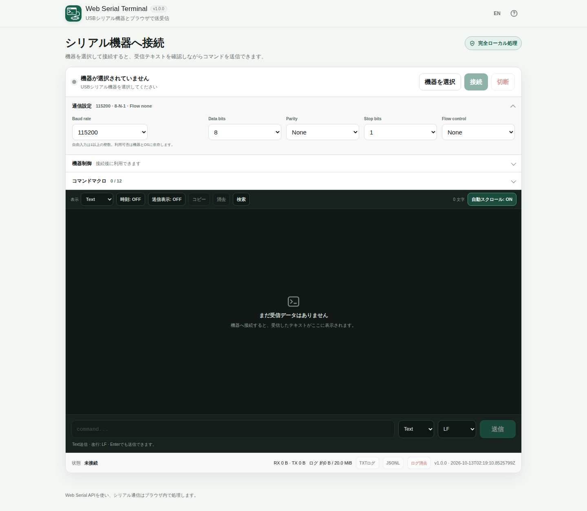

# Web Serial Terminal / シリアル通信ターミナル

[](https://github.com/ttomohisa/htmlapps-web-serial-terminal/actions/workflows/deploy-pages.yml)
[](LICENSE)
[](https://ttomohisa.github.io/htmlapps-web-serial-terminal/)

[English README](README.md)

**Web Serial Terminal** は、ブラウザからシリアル機器へ接続し、Text / HEXの送受信、コマンドマクロ、通信ログの保存を行う単一HTMLのツールです。シリアル通信内容をアプリのサーバーに送信せず、日本語・英語のUIを使えます。

## デモ

### [GitHub PagesでWeb Serial Terminalを開く](https://ttomohisa.github.io/htmlapps-web-serial-terminal/)

GitHub Pagesは最初のHTMLを配信します。読み込み後のシリアル通信は、ブラウザとユーザーが許可した機器の間で直接行われます。通信内容をサーバーへアップロードしません。

[](https://ttomohisa.github.io/htmlapps-web-serial-terminal/)

[スマートフォン画面を確認](assets/screenshot-mobile.png)

## 主な機能

- **Text / HEXの送受信** — 接続先の機器を選び、Baud rateや通信条件を設定。受信データを文字やHEXで表示し、UTF-8テキストや指定したバイト列を送れます。
- **送信方法を細かく設定** — Text送信の改行は「なし / LF / CR / CRLF」から選択。ローカルエコー、時刻表示、セッション内の送信履歴も利用できます。
- **機器の制御** — DTR / RTSを明示的に変更し、BREAKパルスや制御キー（ESC、Ctrl+C、Ctrl+D、Ctrl+Z、Tab）を送信。取得できる入力信号も表示します。
- **受信中も見返しやすい** — 上へスクロールすれば追従を一時停止。「最新へ」で戻り、検索・コピー・表示の消去とUndoもできます。
- **よく使うコマンドをマクロ化** — Text / HEXの送信内容を最大12個、ブラウザ内に保存。名前・改行を指定して、接続中に明示的に実行します。
- **ログを保存** — 時刻と生バイトを含むTXT / JSONLを端末へ保存。概算20 MiBの保存用ログ上限に達しても、**通信そのものは停止しません**。
- **スマートフォンも考慮したUI** — 通信設定・機器制御・マクロへのクイック操作、タップ領域、キーボード表示時のレイアウトに対応。ただしUSBシリアルの利用可否は端末・ブラウザに依存します。

## すぐに使う

### Webで使う

[GitHub Pagesのアプリ](https://ttomohisa.github.io/htmlapps-web-serial-terminal/)を、Web Serial対応ブラウザで開きます。デスクトップ版Chrome/Edgeでは登録や専用ターミナルソフトのインストールは不要です。Firefoxではブラウザが生成するサイト権限アドオンのインストールが必要です。機器をPCへ接続し、ブラウザのポート選択画面で許可してください。

### 単一HTMLをダウンロードして使う

1. このリポジトリの[GitHub Actions](https://github.com/ttomohisa/htmlapps-web-serial-terminal/actions/workflows/deploy-pages.yml)から、成功した実行を開きます。
2. `standalone-html-...` というArtifactをダウンロードし、ZIPを展開します。
3. `dist/index.html` または `dist/index.self-extract.html` を、ローカルファイルでのWeb Serialを利用できるブラウザで開きます。

ビルド時にはリポジトリ直下にも `web-serial-terminal.html` が生成されます。**生成HTMLはソースリポジトリへコミットしていません**。なお、`file://` から開いたときの権限はHTTPSと異なる場合があり、アプリ内の対応判定で確認してください。

### 自分でビルドする（Windows）

1. このリポジトリをダウンロード、またはクローンします。
2. `build-standalone.bat` を実行します（PowerShellなら `./build-standalone.ps1`）。
3. `dist/index.html`（通常版）または `dist/index.self-extract.html`（自己展開版）が生成されます。
4. 生成したHTMLファイルを保存しておけば、以降はランタイムのCDNやサーバーを使わずに実行できます。

標準ビルドにはPowerShellを使います。このアプリにはダウンロードが必要なサードパーティの実行時ライブラリはありません。

## 使い方

1. USBシリアル機器などを接続し、「**機器を選択**」からポートを選びます。
2. 「**通信設定**」でBaud rate、Data bits、Stop bits、Parity、Flow controlを機器に合わせ、「**接続**」を押します。
3. 受信表示を **Text / HEX** から選び、必要なら時刻表示やローカルエコーを切り替えます。
4. 送信形式を **Text / HEX** から選びます。Textは改行方式を指定できます。HEXは入力した生バイトを追加改行なしで送ります。
5. 内容を入力して「**送信**」。DTR / RTS、BREAK、制御キーなどは「**機器制御**」にあります。
6. 受信内容を見返すときは上へスクロール。追従が一時停止し、「**最新へ**」で戻ります。検索とコピーも利用できます。
7. 繰り返すコマンドは「**コマンドマクロ**」へ登録します。マクロはこのブラウザ内に保存され、接続中だけ実行できます。
8. 記録した通信は **TXT / JSONL** で保存します。画面上の「**消去**」と保存用データを消す「**ログ消去**」は別の操作です。
9. 終了時は「**切断**」。USBを抜き差しした場合も、アプリが勝手に接続・送信することはありません。「再接続」から明示的に復旧します。

### よく使う操作

| 操作 | 説明 |
| --- | --- |
| 入力欄で `↑` / `↓` | このページで手入力したコマンドの履歴を呼び出す |
| Text / HEX送信 | TextはUTF-8＋選択した改行、HEXは指定バイトをそのまま送信 |
| 自動追従 / 最新へ | 過去ログを読んでいる間は追従停止。「最新へ」で再開 |
| 消去 / 元に戻す | ターミナルの表示だけを消去。一定時間はUndo可能 |
| ログ消去 | 保存用のセッションログだけを確認後に削除 |
| EN / JA | 日本語・英語を切り替える |
| 使い方と注意事項 | 背後のページは固定し、ダイアログ内だけスクロールできる |

## GitHub Pagesへの公開

[Deploy standalone app to GitHub Pages](.github/workflows/deploy-pages.yml) ワークフローは、`main` へのpushまたは手動実行で動作します。単一HTMLをビルド・検証し、PagesがGitHub Actionsを利用する設定なら `dist/` を公開します。Pages設定がない場合は公開をスキップしますが、それだけでビルド失敗という意味ではありません。

Pull Request時の検証は [Validate standalone HTML](.github/workflows/build-standalone.yml) で行います。

## 開発とビルドの構成

```text
.
├─ src/index.template.html             # アプリ本体
├─ app.config.json                     # 名前・版数・出力先・通信制限
├─ assets/favicon.svg                  # favicon / ヘッダー共通アイコン
├─ assets/screenshot*.png              # 日英、PC・スマホの画面
├─ examples/pico-usb-web-serial-test.py # Pico USB CDCテスト
├─ examples/pico-uart-echo-test.py      # Pico実UARTテスト
├─ docs/HARDWARE_TEST_PICO.ja.md       # Pico実機確認手順
├─ docs/RC_VERIFICATION.ja.md          # 合格 / 未検証項目
├─ tests/                              # 自動回帰テスト
├─ build-standalone.bat                # Windows用ビルド
├─ build-standalone.ps1                # 単一HTML生成処理
├─ dist/index.html                     # 生成される通常版
├─ dist/index.self-extract.html        # 生成される自己展開版
└─ .github/workflows/                  # CI / Pages / Preview
```

ビルドすると通常版と同じ内容の `web-serial-terminal.html` もリポジトリ直下に生成します。生成物を直接編集せず、`src/index.template.html` を修正してください。`scripts/check-repository.ps1` はPowerShell構文、埋込アセット、CSP、生成物の整合性を検証します。

## プライバシーと実行時の通信制限

- シリアル通信内容は、ブラウザとユーザーが選んだ機器の間で直接処理されます。このアプリから通信内容をサーバーへ送信しません。
- オンライン版は最初に**HTTPSでHTMLを取得**します。「完全ローカル処理」は読み込み後のシリアル通信内容についての表現であり、サイト表示まで無通信という意味ではありません。
- 生成HTMLのCSPは `connect-src 'none'`。外部API、実行時CDN、外部フォント、Analytics、Telemetryを利用しません。
- 通信ログはページを開いている間のメモリに保持し、ユーザーが選んだ場合だけTXT / JSONLを保存します。保存用ログは概算20 MiBで記録を止めます。表示履歴には別の制限があります。
- 言語・通信設定・表示設定・ユーザーが作成したマクロはlocalStorageに保存される場合があります。サイトデータの削除で消える場合があります。セッションの通信記録はlocalStorageには保存しません。

## ブラウザ・機器の対応

安全なコンテキストと `navigator.serial` に対応するブラウザが必要です。起動時に実際のAPIを確認し、利用できない環境では接続操作を無効にします。

デスクトップ版Chrome / Edgeを主な対象としています（Pico実機テスト時のブラウザの正確なバージョンは未記録です）。Firefox Desktop 151以降もWeb Serialに対応しますが、接続時にはFirefoxが生成するサイト権限アドオンのインストールが必要です。このアプリのFirefox実機回帰は未確認です。Androidはブラウザ・端末・通信方式で動作が異なり、Bluetooth RFCOMMを利用できる場合がありますが、**Androidの有線USBシリアル対応は保証しません**。iPhone / iPadやWeb Serialを公開しないSafari環境では接続できません。

Raspberry Pi PicoのMicroPython USB CDCでは、Text / HEX送受信、大量受信、マクロ、ログ、永続化、USB抜去・明示的な再接続、約20 MiBログ上限の実機テストに合格しました。ただしUSB CDCだけでは、実UARTのBaud rate / parity / stop bits、DTR/RTS/BREAK、すべての制御バイトの正確さを検証できません。これらの確認には3.3 V USB-UARTアダプタが必要です。

[実機テスト手順](docs/HARDWARE_TEST_PICO.ja.md)と[検証状況一覧](docs/RC_VERIFICATION.ja.md)に、確認結果と未検証項目を記載しています。

## 制限事項

- 生のシリアルデータを扱うターミナルです。ANSI/VT100の画面再現、Modbus、グラフ、ファームウェア書き込みには対応していません。
- 同時に扱うポートは1つで、自動接続・自動送信はしません。
- 選べるBaud rateや通信条件、OSドライバー、USB権限、制御信号は機器・環境に依存します。
- 機器名やCOM番号を取得できない場合があります。同じVID/PIDの機器が複数あれば、再接続時に選び直す必要があります。
- 約20 MiBのログ上限はJavaScriptヒープの実測値ではなく概算です。ログを消す前に必要なファイルを保存してください。
- 設定・マクロの端末間同期と、マクロのインポート / エクスポートはv1.0.0には含みません。

## 使用ライブラリ

**サードパーティのJavaScript / WASMライブラリは使っていません**。ブラウザAPIを使用します。ビルド用Actionsやテンプレート由来の共通部品については [THIRD_PARTY_NOTICES.md](THIRD_PARTY_NOTICES.md) を参照してください。

## 開発への参加

不具合や追加要望は [GitHub Issues](https://github.com/ttomohisa/htmlapps-web-serial-terminal/issues) へお願いします。開発方法は [CONTRIBUTING.md](CONTRIBUTING.md) にあります。

## ライセンス

Copyright © 2026 ttomohisa

[MIT License](LICENSE) で公開しています。
