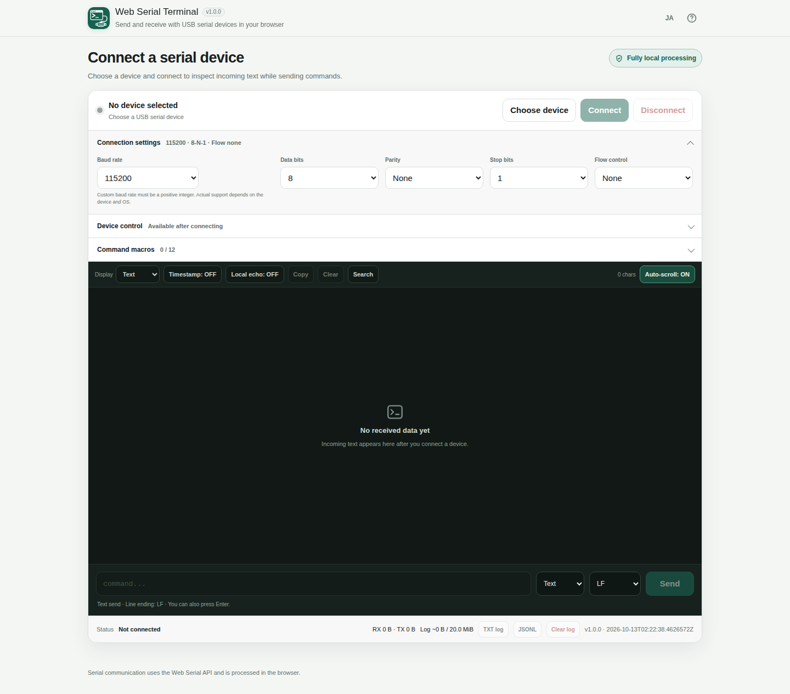

# Web Serial Terminal

[](https://github.com/ttomohisa/htmlapps-web-serial-terminal/actions/workflows/deploy-pages.yml)
[](LICENSE)
[](https://ttomohisa.github.io/htmlapps-web-serial-terminal/)

[日本語版 README](README.ja.md)

**Web Serial Terminal** connects a supported browser to a serial device. Inspect incoming Text or HEX bytes, send commands, reuse local macros, and save session logs without uploading serial data to an application server. It is distributed as a single HTML file, with Japanese and English interfaces.

## Live demo

### [Open Web Serial Terminal on GitHub Pages](https://ttomohisa.github.io/htmlapps-web-serial-terminal/)

GitHub Pages delivers the initial HTML. After the page loads, serial communication takes place directly between the browser and the device you authorize. The app does not upload serial payloads to a server.

[](https://ttomohisa.github.io/htmlapps-web-serial-terminal/)

[View the mobile screenshot](assets/screenshot-mobile-en.png)

## Features

- **Text and HEX serial communication** — Select a permitted device, set baud rate and framing, receive data in Text or HEX, and transmit UTF-8 Text or exact raw bytes.
- **Configurable commands** — Choose None, LF, CR, or CRLF for Text sends; enable local echo or timestamps; use session-only command history.
- **Device controls** — Explicitly set DTR/RTS, send a short BREAK pulse, inspect available input signals, and send ESC, Ctrl+C, Ctrl+D, Ctrl+Z, or Tab.
- **A terminal designed for incoming streams** — Pause follow by scrolling up, jump to the newest output, search received text, copy the display, or clear it with Undo.
- **Reusable command macros** — Save up to 12 named Text/HEX commands locally, edit their framing, and run them explicitly while connected.
- **Exportable session logs** — Save TXT or JSONL with timestamps and raw bytes. The approximate 20 MiB export-log budget stops *recording* when full, not serial communication.
- **Mobile-aware interface** — Larger touch targets, quick access to settings/device controls/macros, and software-keyboard-aware sizing. Actual USB serial availability still depends on the browser and device.

## Quick start

### Use the web app

Open the [GitHub Pages demo](https://ttomohisa.github.io/htmlapps-web-serial-terminal/) in a browser that exposes Web Serial. No account or companion terminal software is required in supported desktop Chrome/Edge browsers. Firefox may require installation of a browser-generated site-permission add-on. Connect the device; the browser asks you to authorize the port.

### Use a standalone HTML file

1. Open this repository's [Actions](https://github.com/ttomohisa/htmlapps-web-serial-terminal/actions/workflows/deploy-pages.yml) and select a successful build.
2. Download the `standalone-html-...` build artifact and extract it.
3. Open `dist/index.html` or `dist/index.self-extract.html` in a browser that supports Web Serial in a local-file context.

The repository also generates a readable repository-root `web-serial-terminal.html` copy during the build. Generated HTML artifacts are **not committed** to the source tree. Browser file:// permissions may differ from HTTPS; check the in-app compatibility notice.

### Build it yourself (Windows)

1. Download or clone this repository.
2. Run `build-standalone.bat` (or `./build-standalone.ps1` in PowerShell).
3. Use the generated `dist/index.html` for the readable single-file version or `dist/index.self-extract.html` for the self-extracting version.
4. Keep the file on your device for later use; the runtime does not require a CDN or application server.

The standard build uses PowerShell. There are no third-party runtime packages to download for this application.

## Usage

1. Attach a USB serial device (or other serial transport supported by the browser) and choose **Choose device**.
2. Under **Connection settings**, set baud rate, data bits, stop bits, parity, and flow control as required by the hardware. Select **Connect**.
3. Watch incoming data in **Text** or **HEX**. Optionally enable timestamps and Local echo.
4. Set the send mode to **Text** or **HEX**. For Text, choose the desired line ending; HEX sends exactly the bytes entered, without an added line ending.
5. Type a command and choose **Send**. Use the **Device control** panel for DTR/RTS, BREAK, input signals, and one-byte control keys.
6. Scroll upward to pause automatic following; choose **Latest** to return to incoming output. Search and Copy operate on the visible display.
7. Add frequently used commands under **Command macros**. Macro definitions are stored in your browser; execution requires an active connection.
8. Save the captured session as **TXT** or **JSONL**. **Clear** affects the terminal display; **Clear log** resets recorded export data only after confirmation.
9. Select **Disconnect** when finished. If a device is unplugged, reconnect explicitly after inserting it again; the app does not automatically reopen ports.

### Common controls

| Control | Behavior |
| --- | --- |
| `↑` / `↓` in the command field | Recall previously typed commands from this page session |
| Text / HEX send mode | Text is UTF-8 plus selected line ending; HEX is exact raw bytes |
| Auto-scroll / Latest | Pauses when reading older output; Latest resumes following |
| Clear / Undo | Hides the current terminal display; undo is available briefly |
| Clear log | Confirms removal of in-memory records used for TXT/JSONL export |
| EN / JA | Switches the interface language |
| Help | Opens the internally scrollable help dialog while locking background page scrolling |

## GitHub Pages publishing

The [Deploy standalone app to GitHub Pages](.github/workflows/deploy-pages.yml) workflow runs on pushes to `main` or by manual dispatch. It builds and verifies the standalone HTML, checks whether GitHub Pages is enabled, and publishes `dist/` when Pages has been configured to use GitHub Actions. A skipped deployment does not imply that the build failed.

See [the repository validation workflow](.github/workflows/build-standalone.yml) for checks performed on pull requests.

## Development and build layout

```text
.
├─ src/index.template.html             # Application source
├─ app.config.json                     # Version, name, build outputs, privacy flags
├─ assets/favicon.svg                  # Canonical embedded app icon
├─ assets/screenshot*.png              # Japanese / English desktop and mobile captures
├─ examples/pico-usb-web-serial-test.py # USB CDC hardware test fixture
├─ examples/pico-uart-echo-test.py      # Real UART test fixture
├─ docs/HARDWARE_TEST_PICO.md          # Pico hardware test procedure
├─ docs/RC_VERIFICATION.md             # Verified / open acceptance checks
├─ tests/                              # Automated regression tests
├─ build-standalone.bat                # Windows build entry
├─ build-standalone.ps1                # Standalone builder
├─ dist/index.html                     # Generated readable standalone file
├─ dist/index.self-extract.html        # Generated self-extracting version
└─ .github/workflows/                  # Build, Pages and preview workflows
```

The build also writes `web-serial-terminal.html` to the repository root as an exact copy of the readable standalone build. Edit `src/index.template.html`, **not** generated output. `scripts/check-repository.ps1` validates PowerShell syntax, asset embedding, CSP, generated outputs, and artifact consistency.

## Privacy and runtime network protection

- The selected serial device exchanges bytes with the browser directly. Serial RX/TX contents are not sent to an application server.
- The hosted demo **downloads its HTML over HTTPS**. “Fully local processing” describes serial data operations after loading; it does not mean opening the site itself requires no network access.
- `connect-src 'none'` in the generated HTML's Content Security Policy blocks runtime network connections. The app contains no external runtime CDN, font, analytics, or telemetry dependency.
- Received/transmitted session records stay in memory and are written to a local TXT/JSONL file only on explicit export. The export log has an approximate 20 MiB memory budget; the display has separate size limits.
- Display preferences, serial settings, language, and user-created macros may be stored in the browser's localStorage. Clearing site data can remove them. No serial session log is stored there.

## Browser and hardware compatibility

A **secure context** and the `navigator.serial` API are required. The app detects those conditions at runtime instead of enabling an unsupported connection button.

Desktop Chrome and Edge are the primary intended targets; the precise browser version used in the Pico USB CDC tests was not recorded. Firefox Desktop 151+ exposes Web Serial but requires installation of a browser-generated site-permission add-on to authorize access. This application's hardware regression on Firefox remains outstanding. On Android, Web Serial availability and supported transports vary; some Bluetooth RFCOMM use cases may be possible, but **general wired USB serial support is not claimed**. Browsers on iPhone/iPad and Safari environments without Web Serial cannot connect.

The app was tested with a Raspberry Pi Pico through MicroPython USB CDC: Text/HEX round trips, streamed output, macros, TXT/JSONL exports, persistence, manual reconnection, and the log limit passed. USB CDC testing does **not** validate real UART baud/parity/stop-bit signaling, DTR/RTS/BREAK, or every control byte. A separate 3.3 V USB-UART adapter is needed for that.

See [Pico hardware test instructions](docs/HARDWARE_TEST_PICO.md) and the [release verification matrix](docs/RC_VERIFICATION.md) for evidence and remaining checks.

## Limitations

- This is a basic raw serial terminal, **not** an ANSI/VT100 emulator, Modbus tool, plotter, or firmware flasher.
- It works with one selected port at a time and does not automatically reconnect or transmit.
- Device/driver/OS support determines which baud rates, line settings, USB permissions, and signal controls work.
- USB VID/PID may be available without a friendly port name. Devices sharing identifiers may require manual selection after reattachment.
- The approximate 20 MiB log budget estimates memory usage; it is not a precise JavaScript heap measurement. Full logs should be saved before clearing.
- Browser preferences and macros are not synchronized, and there is no macro import/export in v1.0.0.

## Dependencies

The runtime uses native browser APIs with **no third-party JavaScript/WASM packages**. Build workflow actions and the template's reusable components are documented in [THIRD_PARTY_NOTICES.md](THIRD_PARTY_NOTICES.md).

## Contributing

Bug reports and feature requests are welcome through [GitHub Issues](https://github.com/ttomohisa/htmlapps-web-serial-terminal/issues). See [CONTRIBUTING.md](CONTRIBUTING.md) for development guidance.

## License

Copyright © 2026 ttomohisa

Licensed under the [MIT License](LICENSE).
